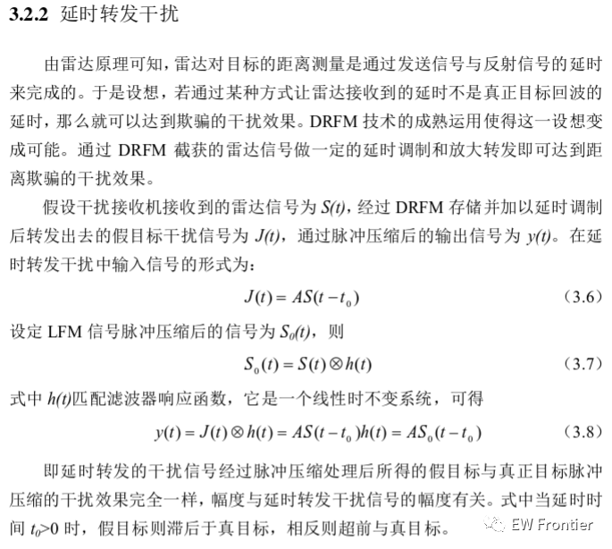
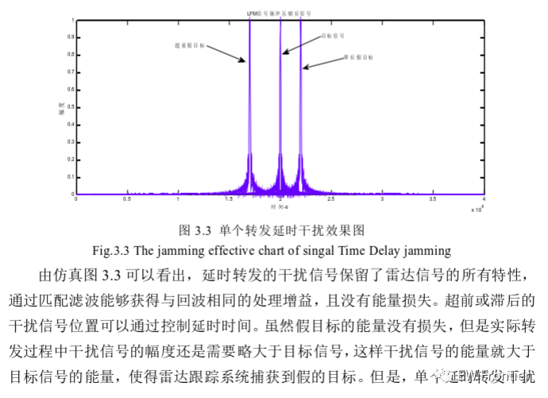
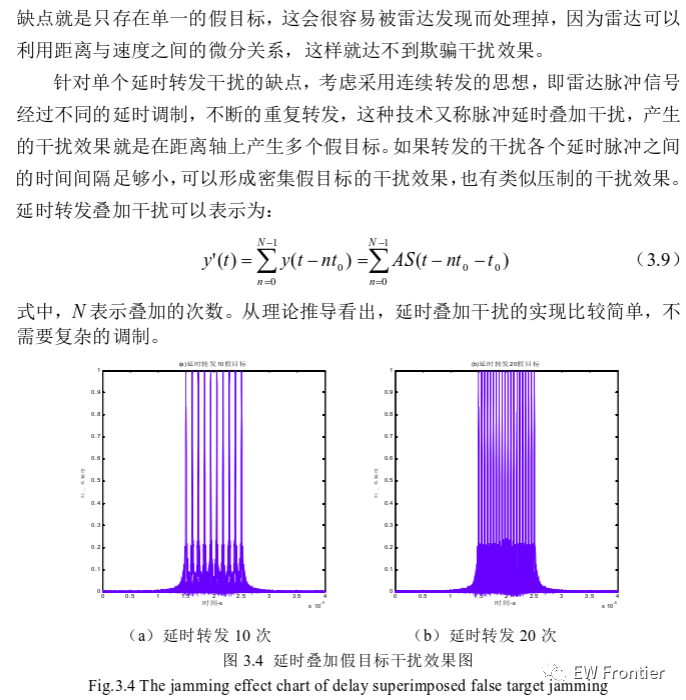
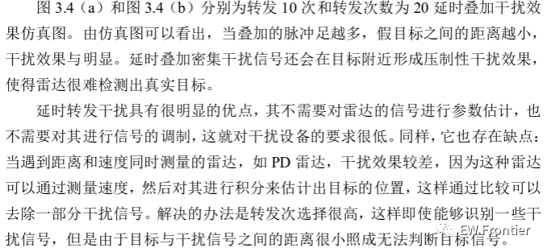
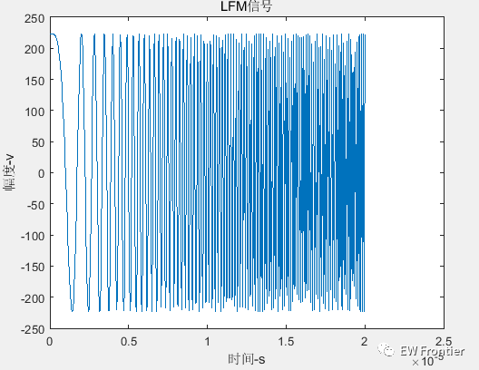
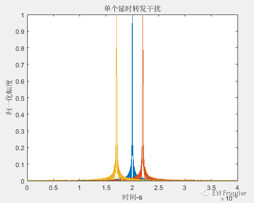
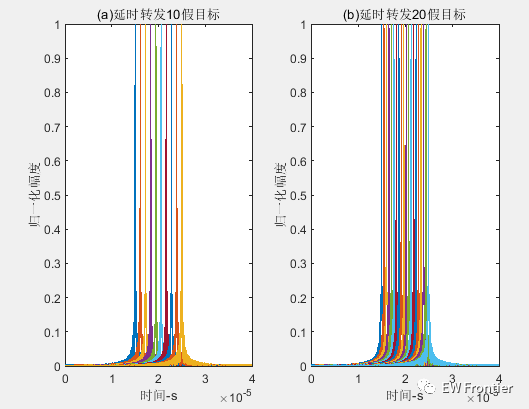

# Radar Jamming: LFM Signal Delayed Forward Interference with MATLAB Code

MATLAB simulation results  
MATLAB code
%%%%%%%%%% Delayed interference\nclear all;close all;clc;\n​\n%%%%%LFM signal%%%%%%%%%%%%%%%%%\nT=20e-6;      % Pulse width is 50us\nB=10e6;        %LFM signal bandwidth\nf0=0;      % Intermediate frequency signal\nK=B/T;        % Frequency modulation slope\nfs=40e6;\nts=1/fs;\nSampleNum=T*fs;\n​\nt=linspace(0,T,SampleNum);\nSt=(1/sqrt(T))*exp(j*pi*K*t.^2+j*2*pi*f0*t);\nHt=(1/sqrt(T))*exp(-j*pi*K*(T-t).^2+j*2*pi*f0*(t-T));\n​\nfigure,plot(t,real(St));\nxlabel('Time-s');\nylabel('Amplitude-v');\ntitle('LFMSignal');\n​\n%%%%%%%% Pulse Compression Module %%%%%%%%%%%\nPulseCompression=conv(St,Ht);\nLen=length(PulseCompression);\naxisX=(1:Len)*ts;\n​\nfigure,plot(axisX,abs(PulseCompression)/max(abs(PulseCompression)));\nxlabel('Time-s');\nylabel('Amplitude');\ntitle('LFMSignal pulse compressed after');\nhold on;\n​  

## Images

<!-- PAYMENT_BLOCK -->

## Get this dataset

- Payment link (Stripe): [Buy now](https://buy.stripe.com/3cs8yP7sY87d0vu9AB)
- Payment QR code: 

<!-- /PAYMENT_BLOCK -->
